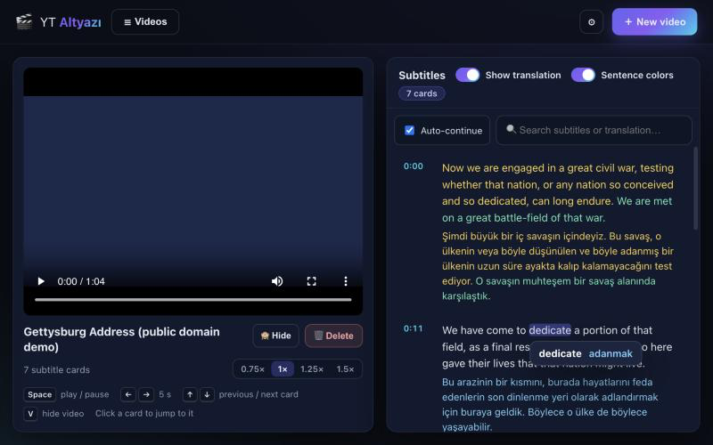
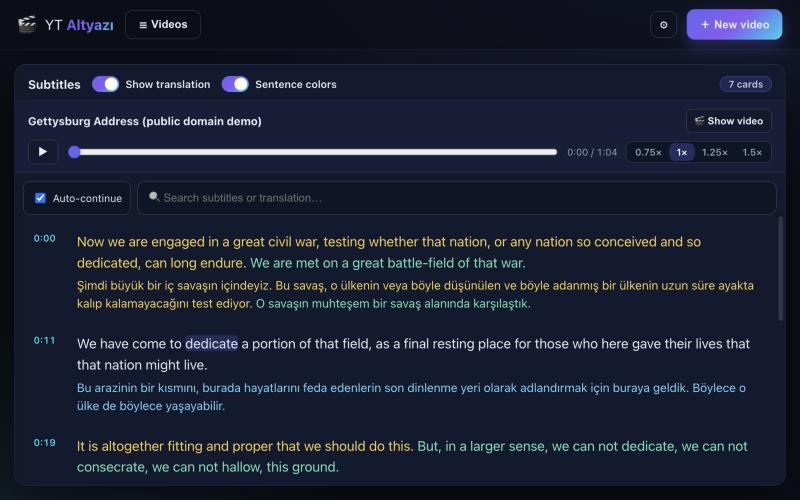
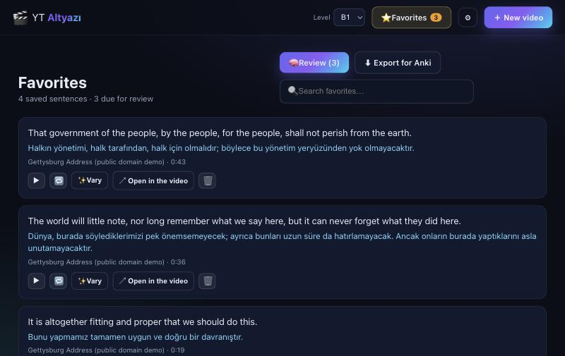
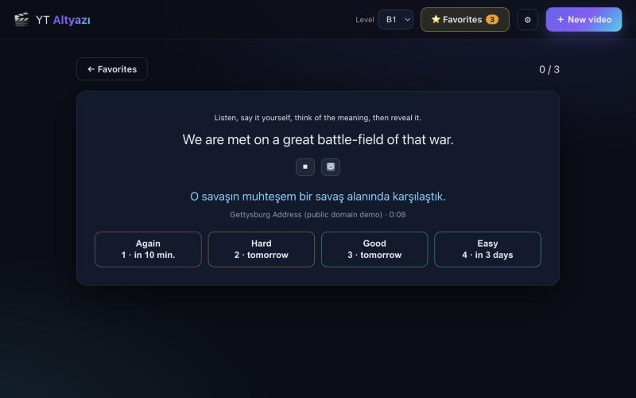
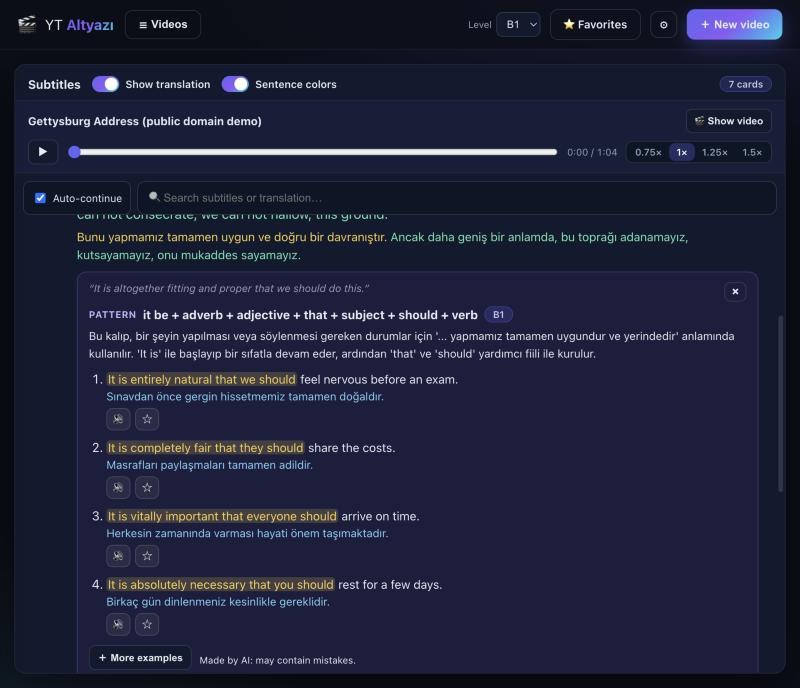
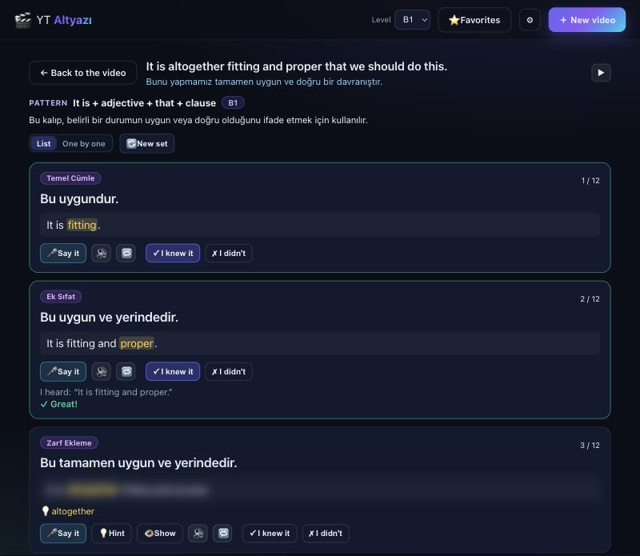

<div align="center">

# 🎬 YT Altyazı

**Learn English from real videos, with subtitles that never cut a sentence in half, translation into your own language, and tools for shadowing. All of it runs on your computer.**

[](https://github.com/mhmmdglc/yt-altyaz-/actions/workflows/ci.yml)
[](LICENSE)


[English](README.md) · [Türkçe](README.tr.md)



</div>

## What is it?

Paste a link to an English video (YouTube or any site [yt-dlp](https://github.com/yt-dlp/yt-dlp) supports). The app downloads it, transcribes it with [Whisper](https://github.com/ggml-org/whisper.cpp), arranges the speech into **cards that never split a sentence**, and translates each card into your language with a local AI model.

Then you study with it: read along while you watch, click a word to see its meaning, and repeat a sentence again and again until you can say it yourself (*shadowing*).

There is **no account, no cloud service and no API key**. The videos, the subtitles and your progress stay on your computer.

It is made for people who learn English by watching: talks, lectures, interviews, podcasts on video, vlogs, series you have the right to download.

## Highlights

- 🧩 **Sentence-accurate cards.** A card holds one or a few *whole* sentences, never half of one. Start and end times are snapped to the real pauses in the audio, so the first word is not clipped and the next sentence does not leak in. ([how](docs/SUBTITLE-CARDS.md))
- 🌍 **Translation into 37 languages**, made on your computer by [HY-MT1.5](https://huggingface.co/tencent/HY-MT1.5-1.8B). Each English sentence and its translation share one colour, so you always see what matches what.
- 👆 **Click any word** to see its meaning in your language, translated on your computer (optionally by Gemini, which picks the meaning that fits *this* sentence).
- 🔁 **Shadowing mode.** Press 🔁 on a card: it plays the sentence, waits one second and plays it again, until you stop it.
- 🎯 **Study by speaking** *(optional, Gemini)*: turn one sentence into a speaking ladder, from its simplest core ("I'm going.") through other subjects, negative, question and added details up to the full sentence. You see each step in your language, **say it in English**, and your voice is checked word by word **on your computer** (Whisper); then reveal the blurred English, listen and repeat.
- ⭐ **Favorites and review.** Save any sentence and review your sentences with spaced repetition: listen, say it, reveal the translation, rate yourself. Export them for Anki.
- ✨ **Vary** *(optional, Gemini)*: finds the grammar pattern of a sentence, explains it in your language and writes new example sentences with the same pattern at your level (A2–C1), and shows **real sentences with the same pattern from your other videos**, playable with their original audio.
- 🎞 **Subtitles on the video** (`C`: English, translation or both, also fullscreen) and a video-only layout (`P` hides the subtitle list).
- 📖 **Text-only mode** (`V`): hide the video and work with the text; a small player bar keeps the audio under control.
- ⏯ Resume where you stopped, 0.75×–1.5× speed, search, keyboard shortcuts.
- 🔒 **Private and offline** after the one-time model download. The AI features are optional and send only the sentence you act on.
- 🗣 Interface in **English** and **Türkçe** (adding a language is one small file).

<table>
<tr>
<td width="50%"><br/><sub><b>Shadowing:</b> the active card repeats until you press ⏹.</sub></td>
<td width="50%"><br/><sub><b>Text-only mode:</b> read and listen without the video.</sub></td>
</tr>
</table>

## How it compares

Many good tools exist for learning from video. They make different trade-offs, and which one fits depends on what you need.

| | **YT Altyazı** | Browser extensions<br/><sub>e.g. [Language Reactor](https://www.languagereactor.com), [Migaku](https://migaku.com)</sub> | Subscription platforms<br/><sub>e.g. FluentU, Yabla, LingQ</sub> | Do it yourself<br/><sub>yt-dlp + Whisper + a player</sub> |
|---|---|---|---|---|
| **Cost** | Free, open source (MIT) | Free tiers plus paid plans | Subscription | Free |
| **Account** | None | Usually | Yes | None |
| **Where your data goes** | Stays on your computer; the optional AI features send only the sentence you act on | Page and translation services in the cloud | Their servers | Local |
| **Content** | Any video you can download | Whatever plays in your browser, including streaming services | Their curated library | Anything |
| **Subtitle lines** | Rebuilt into whole-sentence cards with audio-accurate timing | The subtitle lines the site provides | Curated by the service | You build them |
| **Translation** | Local AI model, 37 languages | Cloud translation services | Included for their content | You build it |
| **Word lookup** | Yes, on your computer (optionally Gemini: the meaning that fits the sentence) | Yes | Yes | No |
| **Speaking practice with feedback** | 🎯 Study: say it, checked word by word on your computer | Varies | Some | No |
| **Grammar patterns and new examples** | ✨ Vary (optional Gemini) + real examples from your own videos | Varies | Lessons, in some | No |
| **Shadowing loop** | Built in | Varies | Varies | Player scripts |
| **Flashcards / spaced repetition** | Favorites with spaced-repetition review; text export for Anki | Yes (e.g. Migaku: cards with screenshot and audio, Anki export) | Yes, in some | No |
| **Setup** | Command line + about 1.5–3.5 GB of models | Install an extension | None | A lot |

*Based on the products' public descriptions in October 2026; they change, so check their sites for current details.*

**Choose YT Altyazı if** you care about privacy or want it all offline, you want to study from videos *you* choose (including your own downloads), you practise shadowing, or you want something free that you can inspect and change.

**Choose something else if** you mainly watch **Netflix or other streaming services** (this app only works with videos it can download), you want a **full flashcard system** with screenshots and audio on every card, your target language is **not English**, you want a **curated course**, or you do not want to use a command line.

## Quick start

You need [Node.js 20+](https://nodejs.org) and a few command-line tools. On **macOS** (Apple Silicon recommended):

```bash
brew install node ffmpeg yt-dlp whisper-cpp llama.cpp   # one-time tools

git clone https://github.com/mhmmdglc/yt-altyaz-.git yt-altyazi
cd yt-altyazi
npm install
npm run setup      # checks your tools and downloads the models (you choose which)
npm start          # starts the app and opens it in your browser
```

That is all. The first time, the app asks which language you want your translations in.

> **Linux and Windows:** the code is written to be portable and the automated tests run on all three systems, but the whole pipeline has so far only been tried on macOS. Instructions and known gaps are in [docs/INSTALL.md](docs/INSTALL.md). Reports and fixes are very welcome.

`npm run doctor` shows what is installed and what is missing at any time.

### What gets downloaded

| What | Size | When | Where |
|---|---|---|---|
| Whisper model (speech → text) | 142 MB – 1.5 GB (you choose) | `npm run setup` | `models/` in the project |
| HY-MT translation model (optional) | 1.9 GB | `npm run setup`, only if you say yes | `~/models/HY-MT1.5-1.8B/` (shared, outside the project) |

Both downloads are checksum-verified and resume if interrupted.

> ⚠️ **Translation model license:** HY-MT is released under the *Tencent HY Community License*, which **does not apply in the European Union, the United Kingdom and South Korea**. Read [docs/TRANSLATION.md](docs/TRANSLATION.md#license) before downloading it. Without it, everything else (downloading, transcription, cards, word-by-word reading, shadowing) still works; you simply get English-only subtitles.

## How to use it

### 1. Add a video

Press **＋ New video**, paste the link and press **Transcribe**. You see the progress (download → audio → transcription → cards) and can close the window: the video opens by itself when it is ready, and the translation continues in the background. Transcribing a 15-minute video takes about 2 minutes on an Apple-silicon Mac.


### 2. Read, listen and click

Click a card to jump to it. The active card is highlighted and the list follows the video. Under every English card is its translation; when a card has several sentences, each sentence and its translation share a colour. **Click any English word** to see what it means.


Word meanings are translated on their own, without the sentence around them, so for words with several senses you get one of them: it is a quick hint, not a dictionary.

### 3. Shadow a sentence

Turn **Auto-continue** off, then press 🔁 on a card. The sentence plays, the app waits one second, and plays it again, over and over, until you press ⏹. Speak along, then try without listening. Lower the speed if the speaker is fast.

### 4. Work with text only

Press `V` (or **🙈 Hide**) to hide the video. The panel gets wider and a small player bar appears; the audio keeps playing.

### 5. Choose your languages

**⚙ Settings** sets the interface language and the language subtitles are translated into. Change it later and each video offers to translate itself into the new language.


### 6. Save sentences and review them

Press ☆ on a card to save a sentence (on a card with several sentences you pick which one). **⭐ Favorites** lists everything you saved: listen to the original audio, repeat it, jump back to that moment in the video, or export the list for Anki (`File → Import`, tab-separated).

**🧠 Review** shows the sentences that are due: listen, say it yourself, think of the meaning, reveal the translation and rate yourself (*Again · Hard · Good · Easy*). Sentences you know come back less often; difficult ones come back sooner. The ⭐ button shows how many are due.

<table>
<tr>
<td width="50%"><br/><sub><b>Favorites:</b> listen, repeat, jump back to the video, export.</sub></td>
<td width="50%"><br/><sub><b>Review:</b> each button shows when the sentence comes back.</sub></td>
</tr>
</table>

### 7. Vary a sentence (optional, Gemini)

Press 🎯 on a card and open the **✨ Vary** tab. You get the grammar pattern of the sentence, a short explanation in your language, and new example sentences with the same pattern at your level (pattern words highlighted, 🔊 to hear them, ☆ to save them); **＋ More examples** writes new ones. Below them are **real sentences with the same pattern from your other videos**, which you can play with their original audio.



Choose your level (A2, B1, B2, C1) on the same page, next to the tabs. Vary needs a free Gemini API key: put `GEMINI_API_KEY=…` in a `.env` file in the project folder, or paste it in **⚙ Settings**. Add a `DEEPSEEK_API_KEY` too and DeepSeek takes over whenever Gemini's quota runs out. [docs/AI.md](docs/AI.md) explains what is sent and what it costs.

### 8. Study a sentence by speaking (optional, Gemini)

Press 🎯 on a card (or on a favorite). A study page opens with a **speaking ladder** built from that sentence: the simplest core first, then other subjects, negative, question, added details, and finally the full sentence and a little beyond.

For each step you see the sentence **in your language**; the English is blurred.

1. Press **🎤 Say it** and say it in English. Your voice is turned into text **on your computer** (Whisper) and compared word by word: *✓ Great!*, *≈ Almost. Missing: is*, or *✗ Not quite*.
2. The English is revealed (or press **👁 Show**, or **💡 Hint** for a few key words first). **🔊** reads it aloud, **🔁** repeats it until you stop it: shadow it.
3. Mark **✓ I knew it / ✗ I didn't**. At the end you can practise only the ones you missed, or add them to **Review**, where they come back in the same direction (your language → say it in English).

Switch between **List** and **One by one** (keys: `M` speak, `Space` show, `L` listen, `1`/`2` mark, `←`/`→` move). **🔄 New set** writes a different ladder.



### Keyboard shortcuts

| Key | Action |
|---|---|
| `Space` | play / pause |
| `←` / `→` | 5 seconds back / forward |
| `↑` / `↓` | previous / next card |
| `V` | hide / show the video |
| `C` | subtitles on the video: none → English → translation → both |
| `P` | hide / show the subtitle list (video only) |
| `Esc` | close a popup, the video list or a dialog |
| `Space`, `1`–`4` | in Review: reveal the translation, then rate *Again / Hard / Good / Easy* |
| `M`, `Space`, `L`, `1`/`2`, `←`/`→` | in Study (one by one): speak, show, listen, mark, move |

More detail: [docs/USAGE.md](docs/USAGE.md).

## How it works

```
link ──yt-dlp──► video ──ffmpeg──► 16 kHz audio ──whisper.cpp──► words with timestamps
                                         │                              │
                                  silence detection              words → sentences
                                         └──────────► times snapped to silences
                                                              │
                                              sentences → cards (never split)
                                                              │
                                  HY-MT (llama.cpp) translates every sentence → your language
```

Whisper's own subtitle segments often end in the middle of a sentence, and translating half a sentence gives bad results. So the app asks Whisper for the time of **every word**, finds the sentences itself, and uses the **silences in the audio** to decide exactly where a card starts and ends. Details and tuning: [docs/SUBTITLE-CARDS.md](docs/SUBTITLE-CARDS.md) · [docs/TRANSLATION.md](docs/TRANSLATION.md) · [docs/ARCHITECTURE.md](docs/ARCHITECTURE.md).

## FAQ

**Is it really free?** Yes. The code is MIT-licensed and the tools and models it uses are free to download (check their licenses, especially the translation model's: [THIRD_PARTY_NOTICES.md](THIRD_PARTY_NOTICES.md)).

**Does it work offline?** After the models are downloaded, yes, except for downloading the videos you ask for. Videos you have already added work completely offline.

**Which languages?** The videos must be in **English** (the speech models are English-only). Subtitles can be translated into 37 languages, including Turkish, Spanish, German, French, Portuguese, Russian, Arabic, Japanese, Korean, Chinese, Hindi and more. The interface itself is available in English and Türkçe.

**How good are the transcription and the translation?** Whisper `medium.en` is very good on clear speech and makes mistakes on heavy accents, music and names. The translation model is small (1.8B parameters) so it is not as strong as the biggest cloud services; it translates each sentence on its own and can miss context. Treat both as study aids, not as authoritative sources, especially for religious, legal or medical content.

**What computer do I need?** An Apple-silicon Mac is the best-tested setup. Other computers work, slower: use a smaller Whisper model (`small.en`) and expect the translation to take longer without a GPU. About 3 GB of RAM is used while translating.

**Can I use Netflix, Disney+ and similar?** No. The app works on video files it can download. Streaming services protect their video.

**Can I add my own video files?** Not from the interface yet; only links. (A pull request for local-file import would be welcome.)

**Where is my data?** In the `data/` folder of the project. Copy it to back it up; delete a video in the app (🗑) to remove it.

**Does it send anything anywhere?** Not unless you turn on the AI features. The app listens on `127.0.0.1` only; network access is used to download the models and the videos you ask for, and to show YouTube thumbnails on the home screen. If you add a Gemini key, the sentence you ✨ Vary or 🎯 Study is sent to Google's Gemini API (and, only if you turn that option on, the sentence of a word you click), nothing else. On Gemini's free tier Google may use what you send to improve its products ([docs/AI.md](docs/AI.md)).

**Is my voice uploaded?** No. In 🎯 Study your recording is transcribed by Whisper on your computer and deleted right after; only the sentence you study goes to Gemini to build the ladder. The browser asks for microphone access the first time.

**Do I need a Gemini key?** No. Everything except ✨ Vary and 🎯 Study works without it. Translation and word meanings always use the local model unless you turn on *Gemini for word meanings* in Settings.

## Known limitations and ideas

- English-only source language; links only (no local file import yet); the Anki export is text-only (no audio clips).
- Linux and Windows are untested end-to-end.
- Very long sentences (a speaker chaining 30 seconds with commas) stay on one long card by design.
- Ideas: local-file import, Anki export, more interface languages, other translation backends. See [CONTRIBUTING.md](CONTRIBUTING.md).

## Privacy and responsible use

- Nothing is uploaded unless you turn on the AI features, and then only the sentence you act on. The app rejects requests from other web pages and only serves your own computer.
- Videos are downloaded by yt-dlp. **Respect the terms of the sites you download from and the copyright of the videos.** This tool is meant for personal study; do not redistribute downloaded videos or transcripts.
- Machine transcription and translation make mistakes.

## Documentation

| | |
|---|---|
| [docs/INSTALL.md](docs/INSTALL.md) | Installing on macOS, Linux and Windows; troubleshooting |
| [docs/USAGE.md](docs/USAGE.md) | Every feature, shortcuts, tips |
| [docs/TRANSLATION.md](docs/TRANSLATION.md) | The translation model: setup, license, using it from other programs |
| [docs/AI.md](docs/AI.md) | Optional Gemini features: key, privacy, cost, models |
| [docs/SUBTITLE-CARDS.md](docs/SUBTITLE-CARDS.md) | How cards and timings are made, and how to tune them |
| [docs/CONFIGURATION.md](docs/CONFIGURATION.md) | Environment variables, folders, files |
| [docs/ARCHITECTURE.md](docs/ARCHITECTURE.md) | Code layout, data format, HTTP API |
| [CONTRIBUTING.md](CONTRIBUTING.md) · [SECURITY.md](SECURITY.md) · [CHANGELOG.md](CHANGELOG.md) | Helping out · reporting vulnerabilities · what changed |

## Contributing

Bug reports, fixes, interface translations and testing on Linux and Windows are all very welcome: see [CONTRIBUTING.md](CONTRIBUTING.md).

## License

[MIT](LICENSE) for the code in this repository. The models and tools it uses have their own licenses: see [THIRD_PARTY_NOTICES.md](THIRD_PARTY_NOTICES.md).

Built on the shoulders of [whisper.cpp](https://github.com/ggml-org/whisper.cpp), [llama.cpp](https://github.com/ggml-org/llama.cpp), [yt-dlp](https://github.com/yt-dlp/yt-dlp), [FFmpeg](https://ffmpeg.org) and [HY-MT](https://huggingface.co/tencent/HY-MT1.5-1.8B). The Gettysburg Address used in the screenshots is in the public domain.
