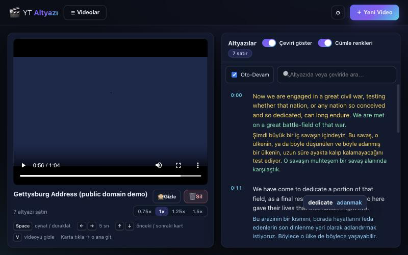
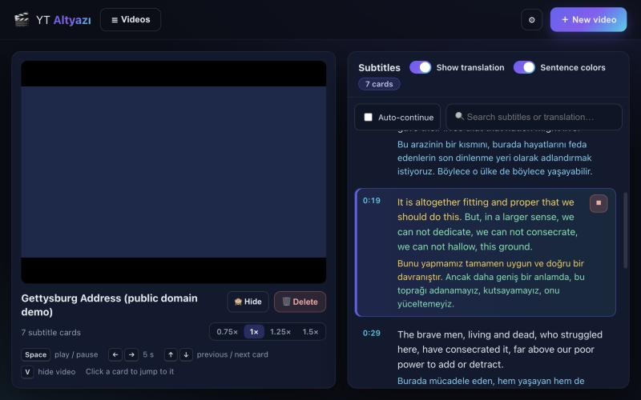
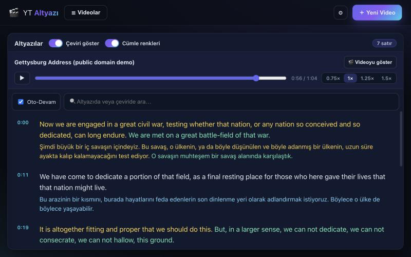
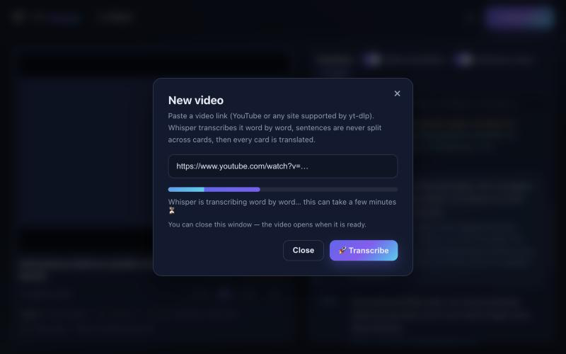
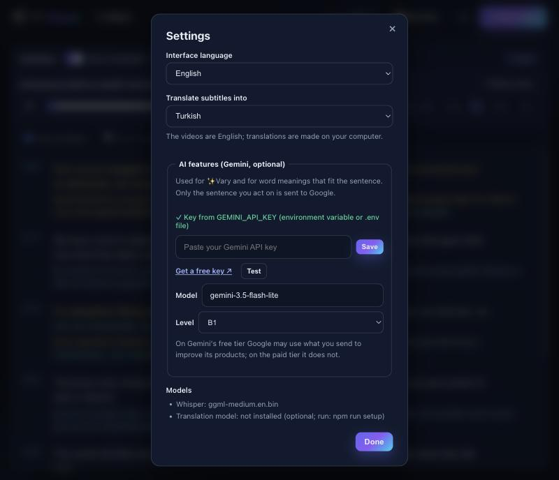
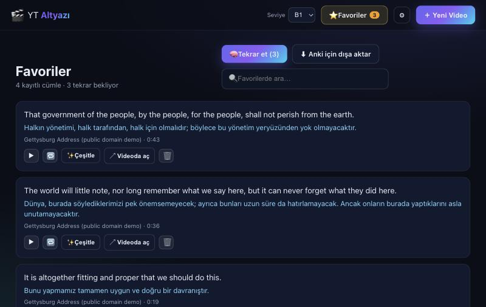
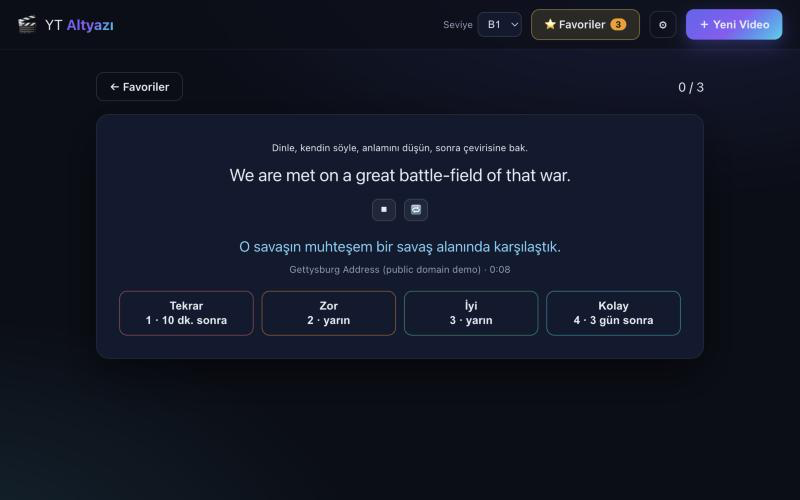

<div align="center">

# 🎬 YT Altyazı

**Gerçek videolardan İngilizce öğren: cümlesi yarıda kesilmeyen altyazılar, kendi dilinde çeviri ve shadowing araçları. Hepsi kendi bilgisayarında çalışır.**

[](https://github.com/mhmmdglc/yt-altyaz-/actions/workflows/ci.yml)
[](LICENSE)


[English](README.md) · [Türkçe](README.tr.md)



</div>

## Nedir?

İngilizce bir videonun linkini yapıştır (YouTube ya da [yt-dlp](https://github.com/yt-dlp/yt-dlp)'nin desteklediği herhangi bir site). Uygulama videoyu indirir, [Whisper](https://github.com/ggml-org/whisper.cpp) ile yazıya döker, konuşmayı **hiçbir cümlesi bölünmeyen kartlara** dizer ve her kartı yerel bir yapay zekâ modeliyle kendi dilinde çevirir.

Sonra onunla çalışırsın: izlerken okursun, bir kelimeye tıklayıp anlamını görürsün, bir cümleyi kendin söyleyebilene kadar tekrar tekrar dinlersin (*shadowing*).

**Hesap, bulut servisi ve API anahtarı yok.** Videolar, altyazılar ve ilerlemen bilgisayarında kalır.

İzleyerek İngilizce öğrenenler için yapıldı: konuşmalar, dersler, röportajlar, görüntülü podcast'ler, vlog'lar, indirme hakkın olan diziler.

## Öne çıkanlar

- 🧩 **Cümle bölünmeyen kartlar.** Bir kart bir ya da birkaç *tam* cümle içerir, hiçbir cümlenin yarısını değil. Başlangıç ve bitişler sesteki gerçek duraklamalara oturtulur: ilk kelime kesilmez, sonraki cümle araya sızmaz. ([nasıl](docs/SUBTITLE-CARDS.md))
- 🌍 **37 dile çeviri**, bilgisayarında [HY-MT1.5](https://huggingface.co/tencent/HY-MT1.5-1.8B) ile. Her İngilizce cümle ile çevirisi aynı renkte görünür, neyin neyle eşleştiği hep belli.
- 👆 **Herhangi bir kelimeye tıkla**, anlamını kendi dilinde gör (opsiyonel Gemini anahtarıyla: *o cümleye* uyan anlamı).
- 🔁 **Shadowing modu.** Bir kartta 🔁'ye bas: cümle çalar, 1 sn bekler, sen durdurana kadar tekrar çalar.
- ⭐ **Favoriler ve tekrar.** İstediğin cümleyi kaydet, aralıklı tekrarla çalış: dinle, söyle, çeviriyi aç, kendini değerlendir. Anki'ye aktarabilirsin.
- ✨ **Çeşitle** *(opsiyonel, Gemini)*: cümlenin gramer kalıbını bulur, kendi dilinde açıklar, seviyene göre (A2–C1) aynı kalıpla yeni örnek cümleler yazar ve **diğer videolarından aynı kalıbı kullanan gerçek cümleleri** orijinal sesiyle gösterir.
- 📖 **Yalnız metin modu** (`V`): videoyu gizle, metinle çalış; küçük oynatıcı çubuğu sesi yönetir.
- ⏯ Kaldığın yerden devam, 0,75×–1,5× hız, arama, klavye kısayolları.
- 🔒 Tek seferlik model indirmesinden sonra **gizli ve çevrimdışı**. Yapay zekâ özellikleri isteğe bağlıdır ve yalnızca üzerinde çalıştığın cümleyi gönderir.
- 🗣 Arayüz **Türkçe** ve **English** (yeni dil eklemek tek küçük bir dosya).

<table>
<tr>
<td width="50%"><br/><sub><b>Shadowing:</b> etkin kart ⏹'e basana kadar tekrar eder.</sub></td>
<td width="50%"><br/><sub><b>Yalnız metin modu:</b> videosuz oku ve dinle.</sub></td>
</tr>
</table>

## Alternatiflerden farkı

Videodan öğrenmek için pek çok iyi araç var. Hepsi farklı tercihler yapıyor; hangisi uygun, neye ihtiyacın olduğuna bağlı.

| | **YT Altyazı** | Tarayıcı eklentileri<br/><sub>ör. [Language Reactor](https://www.languagereactor.com), [Migaku](https://migaku.com)</sub> | Abonelik platformları<br/><sub>ör. FluentU, Yabla, LingQ</sub> | Kendin yap<br/><sub>yt-dlp + Whisper + oynatıcı</sub> |
|---|---|---|---|---|
| **Ücret** | Ücretsiz, açık kaynak (MIT) | Ücretsiz katman + ücretli planlar | Abonelik | Ücretsiz |
| **Hesap** | Yok | Genelde var | Var | Yok |
| **Verilerin nereye gider** | Bilgisayarında kalır; opsiyonel yapay zekâ özellikleri yalnızca üzerinde çalıştığın cümleyi gönderir | Bulutta sayfa ve çeviri servisleri | Onların sunucuları | Yerel |
| **İçerik** | İndirebildiğin her video | Tarayıcında oynayan her şey, yayın servisleri dahil | Kendi seçili kütüphaneleri | Her şey |
| **Altyazı satırları** | Ses doğruluğunda zamanlı, tam cümle kartlarına yeniden kurulur | Sitenin verdiği altyazı satırları | Servisin hazırladığı altyazılar | Sen kurarsın |
| **Çeviri** | Yerel yapay zekâ, 37 dil | Bulut çeviri servisleri | Kendi içerikleri için dahil | Sen kurarsın |
| **Kelime anlamı** | Var; opsiyonel Gemini anahtarıyla cümleye uygun | Var | Var | Yok |
| **Gramer kalıbı ve yeni örnekler** | ✨ Çeşitle (opsiyonel Gemini) + kendi videolarından gerçek örnekler | Değişir | Bazılarında ders olarak | Yok |
| **Shadowing döngüsü** | Hazır | Değişir | Değişir | Oynatıcı betikleri |
| **Flashcard / aralıklı tekrar** | Favorilerde aralıklı tekrar; Anki için metin aktarımı | Var (ör. Migaku: ekran görüntüsü ve sesli kartlar, Anki'ye aktarım) | Bazılarında var | Yok |
| **Kurulum** | Komut satırı + yaklaşık 1,5–3,5 GB model | Eklenti kur | Yok | Çok |

*Ürünlerin Ekim 2026'daki herkese açık tanıtımlarına dayanır; değişebilir, güncel bilgi için sitelerine bak.*

**YT Altyazı'yı seç:** gizlilik senin için önemliyse ya da her şeyin çevrimdışı olmasını istiyorsan, *kendi seçtiğin* videolardan (kendi indirdiklerin dahil) çalışmak istiyorsan, shadowing yapıyorsan ya da incelemek ve değiştirmek istediğin ücretsiz bir araç arıyorsan.

**Başka bir şey seç:** ağırlıklı olarak **Netflix ve diğer yayın servislerini** izliyorsan (bu uygulama yalnızca indirebildiği videolarla çalışır), her kartında ekran görüntüsü ve ses olan **tam bir flashcard sistemi** istiyorsan, hedef dilin **İngilizce değilse**, **hazır bir kurs** istiyorsan ya da komut satırı kullanmak istemiyorsan.

## Hızlı başlangıç

[Node.js 20+](https://nodejs.org) ve birkaç komut satırı aracı gerekir. **macOS**'ta (Apple Silicon önerilir):

```bash
brew install node ffmpeg yt-dlp whisper-cpp llama.cpp   # tek seferlik araçlar

git clone https://github.com/mhmmdglc/yt-altyaz-.git yt-altyazi
cd yt-altyazi
npm install
npm run setup      # araçları kontrol eder, modelleri indirir (hangilerini sen seçersin)
npm start          # uygulamayı başlatır ve tarayıcıda açar
```

Hepsi bu. İlk açılışta uygulama çevirilerin hangi dilde olmasını istediğini sorar.

> **Linux ve Windows:** kod taşınabilir yazıldı ve otomatik testler üç sistemde de çalışıyor, ancak tüm hat şimdilik yalnızca macOS'ta denendi. Kurulum bilgileri ve bilinen eksikler [docs/INSTALL.md](docs/INSTALL.md) içinde (İngilizce). Geri bildirim ve düzeltmelere açığız.

`npm run doctor` komutu istediğin zaman neyin kurulu, neyin eksik olduğunu gösterir.

### Neler indirilir

| Ne | Boyut | Ne zaman | Nereye |
|---|---|---|---|
| Whisper modeli (konuşma → yazı) | 142 MB – 1,5 GB (sen seçersin) | `npm run setup` | proje içinde `models/` |
| HY-MT çeviri modeli (opsiyonel) | 1,9 GB | `npm run setup`, yalnızca "evet" dersen | `~/models/HY-MT1.5-1.8B/` (ortak, proje dışında) |

İki indirme de sağlama toplamıyla doğrulanır ve kesilirse kaldığı yerden devam eder.

> ⚠️ **Çeviri modeli lisansı:** HY-MT, *Tencent HY Community License* ile yayınlanır; bu lisans **Avrupa Birliği, Birleşik Krallık ve Güney Kore'de geçerli değildir**. İndirmeden önce [docs/TRANSLATION.md](docs/TRANSLATION.md#license) bölümünü oku. Modeli indirmesen de geri kalan her şey (indirme, transkripsiyon, kartlar, kelime kelime okuma, shadowing) çalışır; sadece altyazılar yalnızca İngilizce olur.

## Nasıl kullanılır

### 1. Video ekle

**＋ Yeni Video**'ya bas, linki yapıştır ve **Transkribe Et**'e bas. İlerlemeyi görürsün (indirme → ses → transkripsiyon → kartlar), pencereyi kapatabilirsin: video hazır olunca kendiliğinden açılır, çeviri arka planda sürer. 15 dakikalık bir videonun yazıya dökülmesi Apple Silicon'lu bir Mac'te yaklaşık 2 dakika sürer.



### 2. Oku, dinle, tıkla

Karta tıkla, o ana git. Etkin kart vurgulanır ve liste videoyla birlikte kayar. Her İngilizce kartın altında çevirisi vardır; kartta birkaç cümle varsa her cümle ile çevirisi aynı renktedir. **Herhangi bir İngilizce kelimeye tıkla**, anlamını gör.


Kelime anlamları kelimenin çevresindeki cümle olmadan, tek başına çevrilir; birden çok anlamı olan kelimelerde bunlardan biri gösterilir. Hızlı bir ipucudur, sözlük değil.

### 3. Bir cümleyi shadowing ile çalış

**Oto-Devam**'ı kapat, sonra bir kartta 🔁'ye bas. Cümle çalar, uygulama 1 saniye bekler ve cümleyi sen ⏹'e basana kadar tekrar tekrar çalar. Konuşmacıyla birlikte söyle, sonra dinlemeden dene. Konuşmacı hızlıysa hızı düşür.

### 4. Yalnız metinle çalış

Videoyu gizlemek için `V`'ye bas (ya da **🙈 Gizle**). Panel genişler, küçük bir oynatıcı çubuğu çıkar; ses çalmaya devam eder.

### 5. Dillerini seç

**⚙ Ayarlar**'dan arayüz dilini ve altyazıların çevrileceği dili seç. Sonradan değiştirirsen her video kendini yeni dile çevirmeyi önerir.



### 6. Cümleleri kaydet ve tekrar et

Bir cümleyi kaydetmek için karttaki ☆'ye bas (birden çok cümleli kartta hangisini istediğini seçersin). **⭐ Favoriler** kaydettiğin her şeyi listeler: orijinal sesini dinle, tekrarla, videoda o ana dön ya da listeyi Anki için dışa aktar (`Dosya → İçe Aktar`, sekmeyle ayrılmış).

**🧠 Tekrar et** sırası gelen cümleleri gösterir: dinle, kendin söyle, anlamını düşün, çeviriyi aç ve kendini değerlendir (*Tekrar · Zor · İyi · Kolay*). Bildiğin cümleler daha seyrek, zorlandıkların daha sık gelir. ⭐ düğmesi kaç cümlenin sırası geldiğini gösterir.

<table>
<tr>
<td width="50%"><br/><sub><b>Favoriler:</b> dinle, tekrarla, videoya dön, dışa aktar.</sub></td>
<td width="50%"><br/><sub><b>Tekrar:</b> her düğme cümlenin ne zaman geri geleceğini gösterir.</sub></td>
</tr>
</table>

### 7. Bir cümleyi çeşitle (opsiyonel, Gemini)

Bir kartta ✨'e bas. Cümlenin gramer kalıbı, kendi dilinde kısa bir açıklama ve seviyene uygun, aynı kalıpla yazılmış yeni örnek cümleler gelir (kalıp kelimeleri vurgulu, 🔊 ile dinle, ☆ ile kaydet). **＋ Daha fazla örnek** yenilerini yazar. Altında **diğer videolarından aynı kalıbı kullanan gerçek cümleler** var, orijinal sesleriyle dinleyebilirsin.

Seviyeni (A2, B1, B2, C1) üst menüden seç. Çeşitle ücretsiz bir Gemini API anahtarı ister: nasıl ekleneceği, neyin gönderildiği ve ücreti [docs/AI.md](docs/AI.md) içinde (İngilizce).

### Klavye kısayolları

| Tuş | İşlev |
|---|---|
| `Space` | oynat / duraklat |
| `←` / `→` | 5 sn geri / ileri |
| `↑` / `↓` | önceki / sonraki kart |
| `V` | videoyu gizle / göster |
| `Esc` | pencereyi / listeyi kapat |
| `Space`, `1`–`4` | Tekrar ekranında: çeviriyi aç, sonra *Tekrar / Zor / İyi / Kolay* |

Daha fazla ayrıntı: [docs/USAGE.md](docs/USAGE.md) (İngilizce).

**macOS'ta çift tıklanan uygulama:** `scripts/create-macos-app.sh --browser "Google Chrome"` masaüstüne, sunucuyu başlatıp tarayıcıda açan bir uygulama koyar.

## Nasıl çalışır

```
link ──yt-dlp──► video ──ffmpeg──► 16 kHz ses ──whisper.cpp──► zaman damgalı kelimeler
                                       │                             │
                                 sessizlik tespiti            kelimeler → cümleler
                                       └─────────► zamanlar sessizliğe oturtulur
                                                            │
                                            cümleler → kartlar (asla bölünmez)
                                                            │
                               HY-MT (llama.cpp) her cümleyi senin dilinde çevirir
```

Whisper'ın kendi altyazı parçaları çoğu zaman cümlenin ortasında biter ve yarım cümleyi çevirmek kötü sonuç verir. Bu yüzden uygulama Whisper'dan **her kelimenin** zamanını ister, cümleleri kendisi bulur ve bir kartın tam nerede başlayıp biteceğine **sesteki sessizliklere** bakarak karar verir. Ayrıntılar: [docs/SUBTITLE-CARDS.md](docs/SUBTITLE-CARDS.md) · [docs/TRANSLATION.md](docs/TRANSLATION.md) · [docs/ARCHITECTURE.md](docs/ARCHITECTURE.md) (İngilizce).

## Sık sorulan sorular

**Gerçekten ücretsiz mi?** Evet. Kod MIT lisanslı, kullandığı araç ve modeller de ücretsiz indirilir (lisanslarına, özellikle çeviri modelininkine bak: [THIRD_PARTY_NOTICES.md](THIRD_PARTY_NOTICES.md)).

**Çevrimdışı çalışır mı?** Modeller indirildikten sonra evet; yalnızca istediğin videoları indirmek için internet gerekir. Eklediğin videolar tamamen çevrimdışı çalışır.

**Hangi diller?** Videolar **İngilizce** olmalı (konuşma modelleri yalnızca İngilizce). Altyazılar 37 dile çevrilebilir: Türkçe, İspanyolca, Almanca, Fransızca, Portekizce, Rusça, Arapça, Japonca, Korece, Çince, Hintçe ve daha fazlası. Arayüz İngilizce ve Türkçe.

**Transkripsiyon ve çeviri ne kadar iyi?** Whisper `medium.en` net konuşmada çok iyidir; ağır aksan, müzik ve özel isimlerde hata yapar. Çeviri modeli küçük (1,8 milyar parametre), en büyük bulut servisleri kadar güçlü değil; her cümleyi tek başına çevirir ve bağlamı kaçırabilir. İkisini de çalışma yardımcısı olarak gör, kesin kaynak olarak değil; özellikle dini, hukuki ve tıbbi içerikte.

**Nasıl bir bilgisayar gerekir?** En iyi denenen kurulum Apple Silicon'lu Mac. Diğer bilgisayarlar da çalışır ama daha yavaş: daha küçük bir Whisper modeli (`small.en`) kullan, GPU yoksa çevirinin uzun süreceğini bil. Çeviri sırasında yaklaşık 3 GB RAM kullanılır.

**Netflix, Disney+ gibi servislerde çalışır mı?** Hayır. Uygulama indirebildiği video dosyalarıyla çalışır. Yayın servisleri videolarını korur.

**Kendi video dosyalarımı ekleyebilir miyim?** Arayüzden henüz değil, yalnızca link. (Yerel dosya içe aktarımı için gelen bir pull request çok memnuniyetle karşılanır.)

**Verilerim nerede?** Projenin `data/` klasöründe. Yedeklemek için kopyala; bir videoyu silmek için uygulamada 🗑'ye bas.

**Bir yere bir şey gönderiyor mu?** Yapay zekâ özelliklerini açmadıkça hayır. Uygulama yalnızca `127.0.0.1` üzerinde dinler; internet modelleri, istediğin videoları indirmek ve ana ekranda YouTube kapak resimlerini göstermek için kullanılır. Gemini anahtarı eklersen yalnızca ✨ Çeşitle dediğin cümle ya da tıkladığın kelimenin cümlesi Google'ın Gemini API'sine gider. Gemini'nin ücretsiz katmanında Google gönderdiklerini ürünlerini geliştirmek için kullanabilir ([docs/AI.md](docs/AI.md)).

**Gemini anahtarı şart mı?** Hayır. ✨ Çeşitle dışındaki her şey anahtarsız çalışır; kelime anlamları o zaman yerel modelden gelir.

## Bilinen sınırlar ve fikirler

- Kaynak dil yalnızca İngilizce; yalnızca link (henüz yerel dosya yok); Anki aktarımı yalnızca metin (ses klibi yok).
- Linux ve Windows uçtan uca denenmedi.
- Çok uzun cümleler (konuşmacının virgüllerle 30 saniye zincirlediği cümle) bilerek tek uzun kartta kalır.
- Fikirler: yerel dosya içe aktarma, Anki'ye aktarma, daha çok arayüz dili, başka çeviri modelleri. Bkz. [CONTRIBUTING.md](CONTRIBUTING.md).

## Gizlilik ve sorumlu kullanım

- Yapay zekâ özelliklerini açmadıkça hiçbir şey yüklenmez; açarsan yalnızca üzerinde çalıştığın cümle gider. Uygulama başka web sayfalarından gelen istekleri reddeder ve yalnızca kendi bilgisayarına hizmet eder.
- Videoları yt-dlp indirir. **İndirdiğin sitelerin kullanım koşullarına ve videoların telif haklarına saygı göster.** Araç kişisel çalışma içindir; indirilen videoları ya da metinleri yeniden dağıtma.
- Makine transkripsiyonu ve çevirisi hata yapar.

## Dokümantasyon

Ayrıntılı belgeler İngilizce: [kurulum](docs/INSTALL.md) · [kullanım](docs/USAGE.md) · [çeviri modeli](docs/TRANSLATION.md) · [yapay zekâ (Gemini)](docs/AI.md) · [altyazı kartları](docs/SUBTITLE-CARDS.md) · [yapılandırma](docs/CONFIGURATION.md) · [mimari](docs/ARCHITECTURE.md) · [değişiklikler](CHANGELOG.md).

## Katkı ve lisans

Hata bildirimi, düzeltme, arayüz çevirisi ve Linux/Windows testi çok değerli: [CONTRIBUTING.md](CONTRIBUTING.md). Güvenlik açığı bildirimi için [SECURITY.md](SECURITY.md).

Bu depodaki kod [MIT](LICENSE) lisanslıdır. Kullandığı model ve araçların kendi lisansları vardır: [THIRD_PARTY_NOTICES.md](THIRD_PARTY_NOTICES.md).

[whisper.cpp](https://github.com/ggml-org/whisper.cpp), [llama.cpp](https://github.com/ggml-org/llama.cpp), [yt-dlp](https://github.com/yt-dlp/yt-dlp), [FFmpeg](https://ffmpeg.org) ve [HY-MT](https://huggingface.co/tencent/HY-MT1.5-1.8B) üzerine kuruludur. Ekran görüntülerinde kullanılan Gettysburg Konuşması kamu malıdır.
